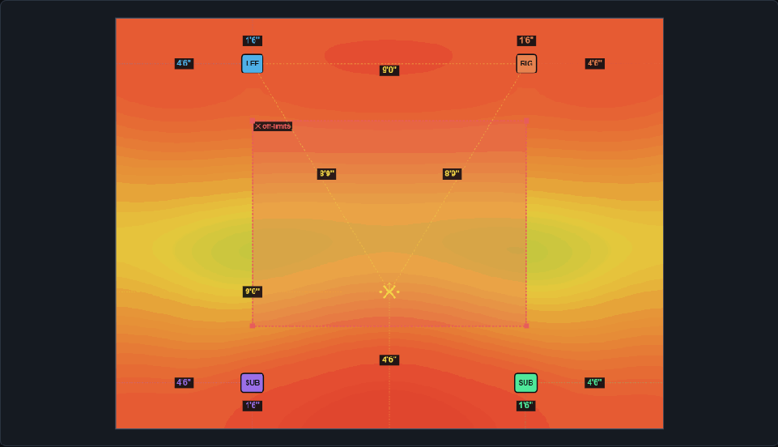
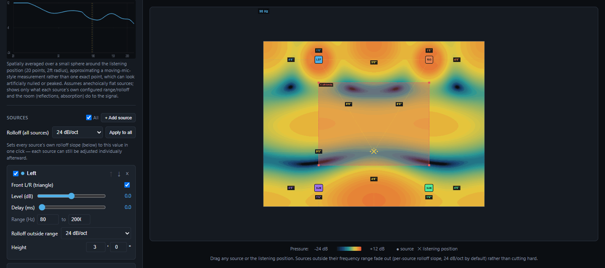

# Modal

Interactive room acoustics simulator: visualize standing waves, find optimal subwoofer placement, and model absorption treatment in real time.

A browser-based tool for reasoning about bass response in a real room. It renders a single-frequency sound-pressure field across the room floor plan (including wall/floor/ceiling reflections), lets you configure speakers, subs, absorption treatment, and room construction, and can automatically search for subwoofer positions that minimize peaks and nulls at your listening position.

No build step, no dependencies: open `src/modal.html` in a browser.



Symmetric sub placement is a classic trap: it's visually tidy, but it excites the room's modes symmetrically too, often carving a null right at the centerline seat where the couch usually is. The sweep above shows exactly that.



Same room, same two subs, same frequency, before/after running the sub-placement optimizer. It deliberately breaks the symmetry to get off the shared null, and both the heat map and the spatially-averaged frequency response chart show the improvement together.

## Screenshots

| | |
|---|---|
|  |  |
| Main view: interference field, sources, and the stereo-triangle guide | Subwoofer placement optimizer, with a score heatmap and suggested position |


Per-wall and ceiling material configuration, each with its own frequency-dependent absorption curve.

## Features

**Sources & listening position**
- Any number of sources (mains, subs), each with independent level, delay, frequency range (with a configurable rolloff slope outside that range, 6/12/18/24 dB/octave, 24 by default, not a hard cutoff, with a bulk "apply to all" control), and height
- "Time-align to listener": sets every source's delay so its direct sound arrives at the listening position together (see [How it works](#how-it-works) below for the real-world caveat this assumes away)
- Reorderable source list; mark exactly two sources as "Front L/R" to show a stereo-triangle guide (distances + geometry) on the map, independent of how many other sources (subs, etc.) exist
- Listener position and facing angle, with a two-ear dB readout (small, frequency-dependent interaural differences)

**Room & reflections**
- 1st/2nd/3rd-order image-source reflections (see [How it works](#how-it-works) below)
- Per-wall material picker (drywall on insulated vs. hollow cavity, masonry), each with its own frequency-dependent absorption
- Ceiling material picker (same three, plus suspended acoustic tile), floor material presets (hardwood, thin/thick carpet, or custom)
- Openings on any wall (doorways, open floor plans), movable, any number, each tapering reflectivity near its edges rather than cutting it off sharply
- Wall-mounted absorption panels (thickness-dependent, quarter-wavelength rule, reorderable list) and floor/ceiling rugs & acoustic panels, drawn directly on the map by click-drag

**Subwoofer optimizer**
- Scores candidate positions across a configurable frequency range and set of listening positions
- "Balanced" mode (minimize variance + penalize deep nulls) or "null avoidance" mode (for rooms already using DSP/room correction, where flat average level matters less than avoiding un-fixable nulls), with a spread penalty so multiple subs don't cluster together
- Off-limits and preferred zones, drawn on the map

**Rendering & UI**
- GPU (WebGL) rendering, with a built-in on-demand check that samples points and compares against the CPU path's exact math; GPU falls back to CPU automatically if unavailable
- Frequency sweep animation (play/pause, adjustable speed) with wrap-around
- Frequency response chart: a log-frequency line plot at the listening position, spatially averaged over a small volume rather than one exact point (see [How it works](#how-it-works) below), with its frequency axis tracking the room's own Schroeder frequency
- Feet & inches / meters unit toggle, applied consistently to every length field and on-canvas label in the app; internal storage stays in feet regardless
- Multi-level undo/redo (Ctrl+Z / Ctrl+Y, or buttons) covering the same state a saved preset does; continuous edits like a drag or a held slider collapse into one undo step instead of one per intermediate frame
- Frequency control (slider, sweep, wavelength/active-sources/Schroeder/ear-diff readouts) lives in a panel below the map, next to the visualization it controls; sidebar sections are collapsible (click the chevron) and organized into a workflow (Room → Sources → Frequency response → Optimizer, with less-frequently-touched treatment/rendering sections collapsed by default), and each section's collapsed state persists across reloads
- Adjustable color range and grid resolution (a device/performance preference, kept separate from saved room presets)
- Room presets (save/load/update, `localStorage`-backed) and separate session settings (units, render mode, resolution, color range, optimizer preferences) that persist across reloads independent of any preset

## How it works

The simulator treats sound as a single-frequency steady-state pressure field and sums contributions from every source (and every reflection of every source) at each point on the floor plan. It is **not** a full room-acoustics/FEM simulation. It's a fast, interactive approximation good enough to reason about where nulls and peaks form, not a substitute for measurements.

### Reflections: the image-source method

Instead of tracing rays, the room's six boundaries (four walls, floor, ceiling) are handled by mirroring each source across each boundary it reflects off of, producing "image sources" behind the walls whose direct-path contribution is physically equivalent to a real reflection. Each bounce reduces the source's amplitude by that wall's reflectivity.

- **1st order**: the direct source + one bounce off each of the 6 boundaries (7 total image sources per real source)
- **2nd order**: adds every pair of *different* boundaries bounced off in sequence (37 total)
- **3rd order**: a further bounce on top of that (187 total), more accurate near corners, at a real cost: each order roughly 5x's the image-source count, so this is also the main performance knob

The only sequence excluded is bouncing off the *same* boundary twice in a row (e.g. left then left again). Physically that's just a longer single bounce, not a distinct path, so it isn't worth a separate image source.

### Field summation

At each point, every image source contributes a spherical wave. With source position **s**, field point **p**, wavenumber `k = 2π/λ`, and per-source amplitude `A` (accumulated through every reflection/absorption/rolloff it passed through):

```
re = Σ (A / r) · cos(k·r + φ)
im = Σ (A / r) · sin(k·r + φ)
dB = 20 · log10( √(re² + im²) )
```

where `r` is the distance from that image source to the point (floored at 0.3 m to avoid a singularity right at a source), and `φ` bundles per-source delay and any other phase offset. This is plain complex-exponential wave superposition. The interesting physics is entirely in what feeds into `A`, `r`, and `φ` for each image source, not in the summation itself.

### Delay, time alignment, and a real-world caveat worth knowing

Each source's delay is a genuine time delay (`φ` grows linearly with frequency, `φ = 2π·f·Δt`), the same thing an AVR's per-channel "speaker distance" setting or a DSP delay line does in real life. "Time-align to listener" computes each source's distance to the listening position and delays every source except the farthest one so their direct sound all arrives together.

Applying that number in real life assumes you actually have a way to enter it: a real per-channel delay/distance control (an AVR or DSP setup), not just a subwoofer's 0/180° phase switch. A polarity switch isn't a delay at all, it's a fixed 180° flip applied identically at every frequency, whereas true time delay's phase shift grows with frequency. A continuous phase knob is a step up but still isn't equivalent: it's usually an analog all-pass network tuned around one reference frequency, not a frequency-proportional delay, and it has no ms readout to map back onto this tool's numbers anyway. Even with a real delay control, the number you calculate from a tape-measured distance is only the *geometric* delay, a sub's own onboard DSP/crossover/limiter processing adds its own latency that's rarely published and isn't captured by distance alone, so the calculated starting point is exactly that: a starting point, not the final answer. Verifying (or finding) the true delay in practice means measuring it (e.g. REW's impulse/step response alignment tools), the same instinct as previewing here before trusting the math on its own.

### Absorption: two material shapes

Real wall assemblies (drywall on studs) behave like a lightly-damped mass-spring-mass system: they absorb unusually well in a narrow band around their own resonance (more insulation in the cavity means deeper, broader absorption) and are comparatively reflective elsewhere. That's modeled as a Gaussian dip in reflectivity around a `peakFreq`. Masonry has no membrane to resonate, so it's modeled as flat. Porous/broadband absorbers (rugs, acoustic panels, suspended ceiling tile) don't resonate; they absorb progressively more at higher frequencies, modeled as a logistic ramp instead. Wall/floor/ceiling absorption panels use a separate quarter-wavelength-rule curve: thicker panels absorb lower frequencies more effectively, tapered smoothly at panel edges so a fraction-of-an-inch move can't flip constructive/destructive interference outright.

### Reverberation time & the Schroeder frequency

Below the **Schroeder frequency**, the room's response is dominated by a handful of discrete, individually identifiable modes, which is exactly what this tool visualizes. Above it, modes overlap so densely that a single-frequency snapshot stops being a meaningful diagnostic. It's estimated from room volume `V` and reverberation time `T60` (`f_s = 2000·√(T60/V)`, metric units), and `T60` itself is estimated live from your actual configured wall/floor/ceiling materials via Sabine's formula:

```
T60 = 0.161 · V / A         where A = Σ (surface area × absorption coefficient)
```

Each surface's absorption coefficient is `1 − R²`, converting the amplitude/pressure reflection coefficient used everywhere else in the model into a power/energy quantity, which is what Sabine's formula is defined in terms of. This is a real, live estimate from your room's construction, not a fixed guess, but it deliberately excludes absorption panels, rugs, and openings (localized area patches rather than whole-surface properties), and Sabine's formula itself assumes evenly-distributed, diffuse absorption, which gets less accurate the more a room is dominated by isolated absorptive/reflective patches (furniture, in particular, isn't modeled at all). See the in-app hint next to the Schroeder frequency readout for the live numbers.

### Frequency response: moving-mic-style spatial averaging

The frequency response chart doesn't read dB at one exact point. A true destructive-interference null is a mathematical knife-edge: a fraction-of-an-inch shift can swing the reading by tens of dB even though a real listener's ears occupy a small volume, not a point. Instead, it deterministically samples 20 points through a small sphere (2ft radius) around the listening position, evaluates the field at each, averages their **power** (not dB, and not raw linear pressure), and converts the averaged power back to dB. That mirrors what a real moving-microphone measurement (REW's MMM technique) captures: energy over a swept volume, not a coherent sum across positions or a simple average of already-logarithmic readings. The chart's frequency axis extends to the room's own (worst-case) Schroeder frequency plus 100Hz headroom, sampled across a fixed range so the axis doesn't shift as you drag the frequency slider, rather than a fixed window that's too narrow for a dead room or mostly empty for a live one.


The 20 points themselves aren't randomly scattered: directions come from a Fibonacci lattice (each point stepped by the golden angle) for even angular coverage, and each point's radius is scaled by a cube root rather than linearly, so the cloud fills the sphere's volume with uniform density instead of clustering near the center. Deterministic, not random, so the same inputs always produce the same cloud rather than flickering between redraws. 20 points at this radius already converges to within ~0.01–0.04 dB of a 2000-point reference average across a range of test frequencies, including right at a null; going to 30 or more doesn't meaningfully improve on that.

### What isn't modeled

This is worth being explicit about, since it's easy to over-trust a clean-looking heat map:

- **No furniture, HVAC, window coverings, or anything not explicitly configured.** Real rooms absorb more than their bare wall/floor/ceiling construction suggests.
- **Exact listener position, not a "typical seating area," for the heat map.** A real listening position isn't a mathematical point; the simulated field can look more precisely peaked/nulled than what you'd actually hear with your head's natural movement. The frequency response chart addresses this for its one view (see [How it works](#how-it-works)), but the heat map itself is still an exact-point snapshot.
- **Single frequency at a time.** Real program material is broadband; a frequency sweep animation helps show how quickly the field changes across nearby frequencies, but there's no time-domain/impulse-response view.
- **Material values are illustrative, not measured.** The wall/ceiling presets are typical-construction approximations, not data for your specific walls. Real behavior depends on details a preset can't capture (drywall thickness, stud spacing, how well-sealed the cavity is), so treat the absolute numbers as a starting point, not ground truth.

## Architecture

- `src/room-physics.js`: the entire physics model (image sources, absorption, optimizer scoring, Schroeder/T60 estimate), as pure functions with no DOM/browser dependency. This is the single source of truth; nothing else reimplements this math.
- `src/room-physics.test.js`: a hand-rolled test suite (no framework, no dependencies) covering the physics module. Run with `node src/room-physics.test.js`.
- `src/field-render.js`: turns a precomputed image-source list into pixels, on either a canvas2d (CPU) or WebGL (GPU) path. GPU image-source data rides on float textures (double-buffered, to avoid a CPU/GPU sync stall), not uniform arrays, so it isn't bounded by WebGL1's small uniform-vector budget.
- `src/modal.html`: the UI. DOM wiring, canvas drawing/overlays, presets/session persistence. Delegates all physics to `room-physics.js` and all field rendering to `field-render.js`.
- `tools/`: dev-only scripts for regenerating the screenshots/GIFs in `docs/` (Playwright-driven UI capture, plus a from-scratch renderer for the sphere-sampling visualization). Not part of the app; has its own `package.json`. See `tools/capture-docs-media.js` and `tools/render-sphere-demo.js`.

## Running it

No build step or install required for the app itself.

- **App**: open `src/modal.html` directly in a browser.
- **Tests**: `node src/room-physics.test.js` (plain Node, no dependencies).
- **Regenerating docs/ media**: `cd tools && npm install`, then `npm run capture-docs-media` and/or `npm run render-sphere-demo`.

## Credits

Built in collaboration with [Claude](https://claude.com/claude-code): the physics model, rendering, UI, tests, and this README were all written with Claude, working from the project owner's direction and review.
