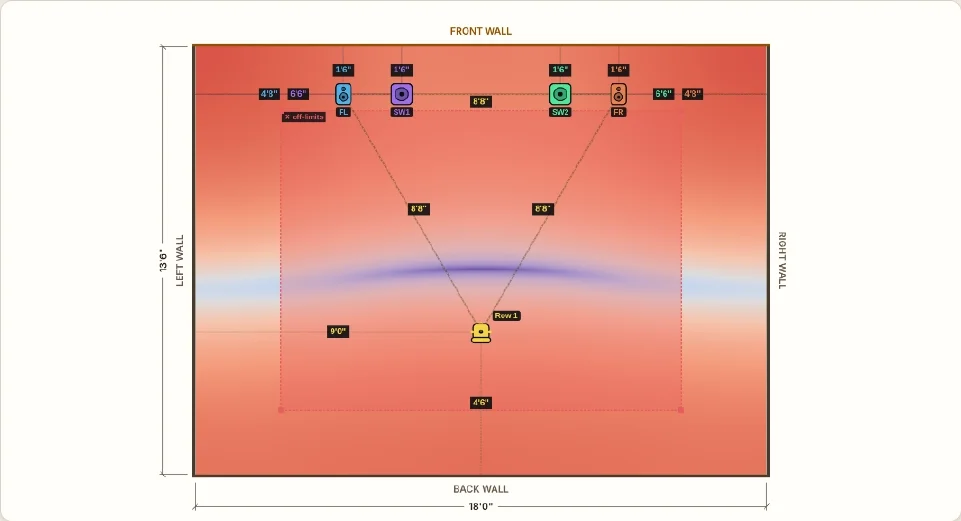
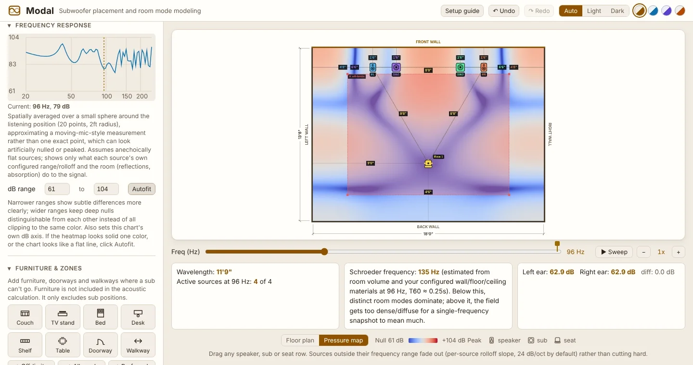
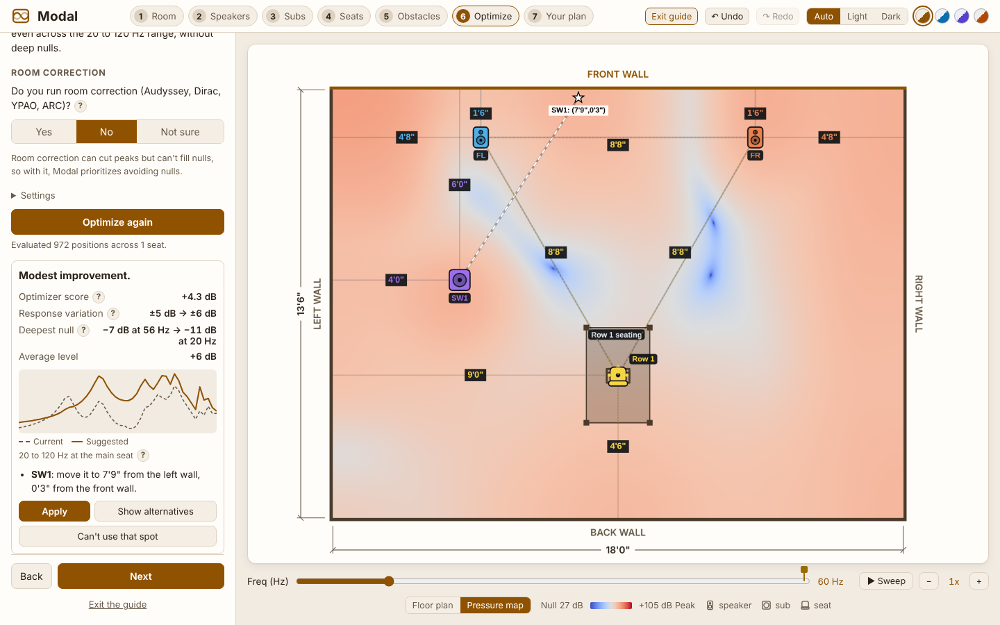
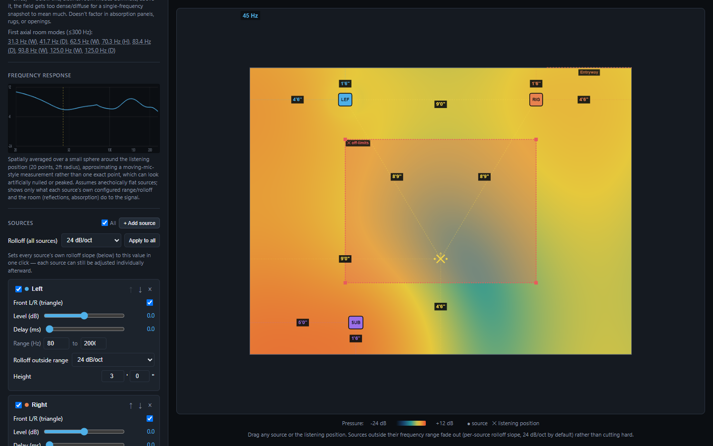

# Modal

A browser-based bass simulator for home theaters and listening rooms. Enter your room, speakers, subs and seats, see where peaks and nulls form, and let the optimizer find better subwoofer positions.

**[Try it live](https://seandrozd.github.io/Modal/)**, or open `src/modal.html` in a browser. No build step, no install.



Symmetric sub placement looks tidy but excites the room's modes symmetrically, often putting a null right at the center seat. The optimizer breaks that symmetry; the heat map and the averaged frequency response improve together:



## Screenshots



| | |
|---|---|
|  |  |
| Main view | Optimizer score heatmap |


## Features

- **Setup guide.** Opens on first launch (skippable, reopen from the header). Seven steps: room, speaker layout (stereo through 9.x), subs you have or plan to buy, seat rows, furniture and no-go areas, optimize, and a printable setup sheet with each sub's distance from two walls and AVR distance advice. The room step offers rectangle, L, T and U shapes with a picture, then each wall's length. Open plans, sloped ceilings and angled walls get a "results won't be reliable" warning. Less common terms have a "?" definition.
- **Room shape.** Any floor plan with square corners: a rectangle, an L, T or U, or any notched shape. Drag corners and walls on the map, click a corner to cut or fill a notch, or type each wall's length.
- **Optimizer.** Scores candidate sub positions across every seat, weighted by row rank and seat position. Every candidate is measured the way the result card measures the outcome: the response averaged over a 2 ft sphere round each seat, at 192 frequencies across the band. "Even" mode minimizes variation across the band and from seat to seat and penalizes deep nulls, without counting level, since the sub's gain sets it; "Null avoidance" is for rooms with room correction, and scores the deepest null and seat-to-seat variation, which correction can't fix. Multiple subs are placed greedily, then refined with coordinate-descent passes. New subs keep clear of each other and of each speaker's footprint back to its wall. The result is graded as a major, modest, similar, or worse change in score, with thresholds sized to each mode's range (3 and 1 dB in Even, 6 and 2 dB in Null avoidance).
- **Zones and furniture.** Off-limits, allowed-only and preferred zones, plus a furniture palette (couch, TV stand, bed, desk and more). Furniture only excludes sub positions; it is not part of the acoustic model.
- **Sources and seats.** Any number of mains and subs with level, delay, crossover range and slope, and height. Delays auto time-align to the main seat. Multiple ranked seat rows of 1 to 5 seats.
- **Room construction.** Per-wall, floor and ceiling materials, each with a frequency-dependent absorption curve, plus corner bass traps modeled from lab measurements.
- **Views.** Floor plan or pressure map, frequency sweep, frequency response chart with the spread across all seats and an optimizer preview overlay. GPU rendering with CPU fallback.
- **Quality of life.** Undo/redo, saved room presets, feet/meters, Auto/Light/Dark with four color themes, tablet support (768px and up, touch and pen).

## How it works

Modal computes a single-frequency, steady-state pressure field by summing the room's modes up to 300 Hz (including the pressure-zone term). It is meant for the bass range where room modes dominate, not as a substitute for measurement. In a rectangular room the modes are exact:

```
p(r, r_s, f) = Σ_n  A_n · ψ_n(r) · ψ_n(r_s) / (k_n² − k² − j·k·δ_n)
ψ_n(r) = cos(nx·π·x/Lx) · cos(ny·π·y/Ly) · cos(nz·π·z/Lz)
```

- **Other floor plans** with square corners have no formula for their modes, so the floor's part of each mode, the x and y cosines above, is solved numerically: the floor is cut into cells about 10 cm across (finer near inside corners) and its modes below 300 Hz are found from the finite-volume Laplacian, with the height cosine unchanged. A new shape solves in the background in about a second, with a coarser preview first.
- **Damping** per mode comes from the surface absorption at that mode's frequency (Morse/Kuttruff), so axial modes decay more slowly than oblique ones. Drywall is modeled as a resonant absorber (checked against Bradley 1997), masonry as flat, ceiling tile as a ramp fitted to E-400 tile data, and the floor by its construction (slab or joists), since carpet barely affects bass.
- **Frequency range** adapts to the room: it runs to the worst-case Schroeder frequency plus headroom, with T60 estimated from your materials by Eyring's formula.
- **Frequency response** is averaged like a moving mic: 20 deterministic points in a 2 ft sphere around each seat, averaged by power.

  

- **Seat weighting:** each row counts half as much as the one above it; within a row, center seats count fully and the ends count half. The worst null is always found, but its penalty is scaled by that seat's weight.
- **Delay** is true time delay, like an AVR's distance setting, not a sub's phase switch. The geometric figure ignores the sub's own processing latency, so trust room correction's measured distance over it.

**Not modeled:** furniture, openings, rugs and thin wall panels (they do little below 150 Hz); only the walls, floor, ceiling and corner bass traps. The heat map is exact-point, so it looks sharper than what you hear. Material values are typical construction, not measurements of your walls.

## Development

| Path | Role |
|---|---|
| `src/room-physics.js` | All physics and optimizer math, pure functions, no DOM |
| `src/room-physics.test.js` | Test suite: `node src/room-physics.test.js` |
| `src/field-render.js` | Field rendering, CPU (canvas2d) and GPU (WebGL) |
| `src/modal.html`, `src/modal.css` | UI, canvas drawing, presets |
| `src/guide.js` | Setup guide panel, driven through an API object from `modal.html` |
| `tools/` | Dev-only scripts that regenerate `docs/` media |

**Regenerating docs media:**

```sh
cd tools
npm install
npm run capture-docs-media            # screenshots and WebP animations (uses Edge; see the script to switch to Chromium)
npm install --no-save gifenc && npm run render-sphere-demo   # sphere-sampling GIF
```

**Deploying:** GitHub Pages serves the repo as-is (Settings → Pages → deploy from `main`, root). The root `index.html` redirects to `src/modal.html`, and `.nojekyll` skips Jekyll. A Pages site is public even from a private repo.

## Credits

Built with [Claude](https://claude.com/claude-code), from the project owner's direction and review.
