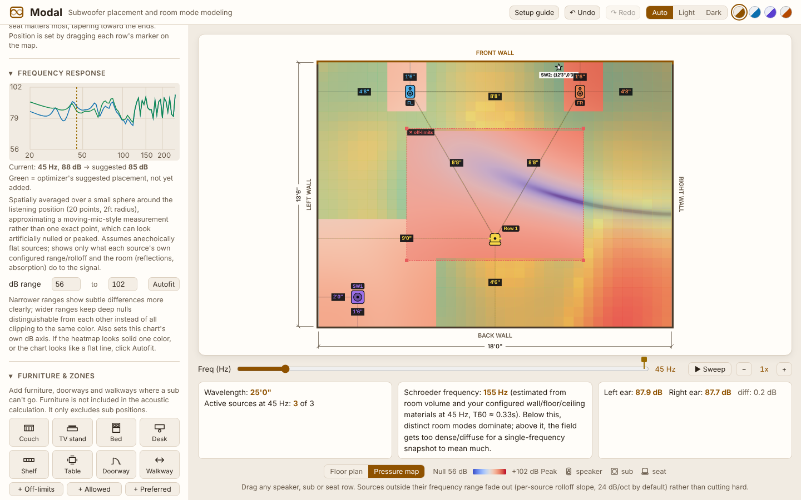
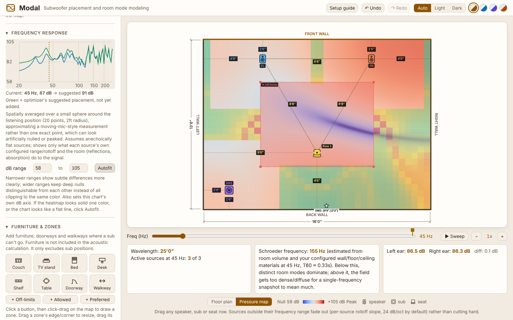
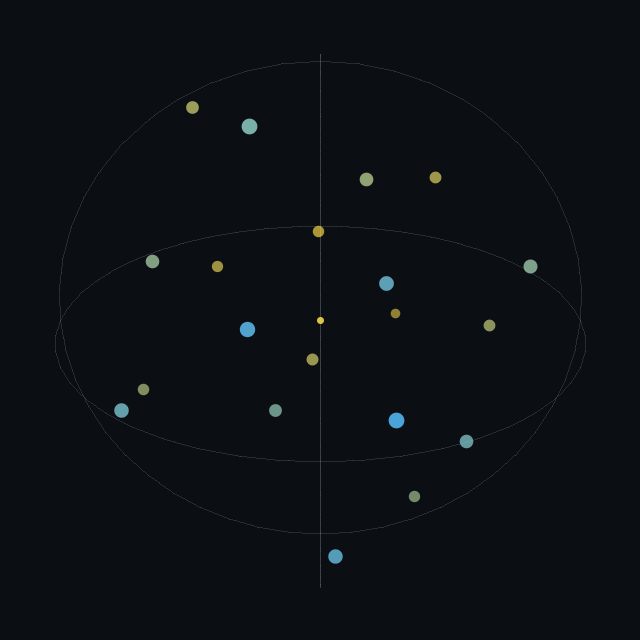

# Modal

Interactive room acoustics simulator: visualize standing waves, find optimal subwoofer placement, and model room construction in real time.

A browser-based tool for reasoning about a room's bass response. It renders a single-frequency sound-pressure field across the room floor plan via an exact rectangular-room modal solution (wall/floor/ceiling material absorption, not individual reflections), lets you configure speakers, subs, and room construction, and can automatically search for subwoofer positions that minimize peaks and nulls at your listening position. Deliberately bass-focused: the modal solution and the UI's frequency range are both scoped to roughly 300Hz and below, where room modes dominate.

No build step, no dependencies: open `src/modal.html` in a browser, or **[try it live](https://seandrozd.github.io/Modal/)**.


Symmetric sub placement is a classic trap: it's visually tidy, but it excites the room's modes symmetrically too, often carving a null right at the centerline seat where the couch usually is. The sweep above shows exactly that.


Same room, same two subs, same frequency, before/after running the sub-placement optimizer. It deliberately breaks the symmetry to get off the shared null, and both the heat map and the spatially-averaged frequency response chart show the improvement together.

## Screenshots

| | |
|---|---|
|  |  |
| Main view: interference field, sources, and the stereo-triangle guide | Subwoofer placement optimizer, with a score heatmap and suggested position |



Per-wall and ceiling material configuration, each with its own frequency-dependent absorption curve.

## Features

**Setup guide**
- Modal opens in the setup guide the first time, with "Skip to the full tool" on the first screen; "Setup guide" in the header reopens it at any time. The guide swaps the sidebar for a step-by-step panel and shows the map as a plain floor plan until there is a result to look at. Closing the page partway through resumes at the same step.
- Seven steps: the room's shape and dimensions (an open or non-rectangular room gets a plain warning that the results won't be reliable, since the model assumes a closed rectangle, and the warning stays on the result and the setup sheet); the speaker layout (stereo through 9.x, or sub only, placed at the standard angles from the seat); the subwoofers you have now, or how many you are planning for; the seat rows; furniture and other places a sub can't go; the optimizer; and a setup sheet. Speakers, subs and seats are positioned by dragging them on the map or entering their distance from two walls.
- The starting "Center (default)" off-limits zone is removed when setup starts, since it is an assumption rather than something in your room. In its place the obstacles step marks each row's seating as a place a sub can't go, once; remove it if a sub could sit there.
- The optimize step asks whether you run room correction (yes selects the "Null avoidance" mode, no or not sure selects "Balanced") and runs the same search as the full tool against your existing subs or the number you plan to buy. The result is measured the way the frequency response chart is (spatially averaged at every seat, across the optimizer's frequency range, with speaker delays re-aligned as they will be once the subs are moved) and graded with the optimizer's own scoring formula, so the verdict cannot disagree with the search: a score gain of 6 dB or more is "major", 2 dB or more "modest", a loss of 2 dB or more says to leave the subs where they are, and anything between says there is little to gain. The card shows that score change with the figures behind it (average level, response variation as the standard deviation across the range, the deepest null and its frequency, and with more than one seat the seat-to-seat variation), next to a before and after response chart. "Show alternatives" overlays the score heatmap, and "Can't use that spot" goes back to the obstacles step.
- The last step is a setup sheet: where each sub goes as distances from its two nearest walls, the geometric distance from each sub to the main seat, and what to do about the AVR's sub distance (room correction measures it and includes the sub's processing delay, so its figure is the one to keep). It can be saved as a room preset and printed; the printed page is the sheet and the floor plan in the light palette.

**Sources & listening positions**
- "+ Add Main" and "+ Add Sub" add a source with the right crossover range already set (80Hz to 20kHz for mains, 20 to 80Hz for subs); Add Main cycles through standard channel abbreviations in layout order (FL, FR, C, SL, SR, SBL, SBR, FWL, FWR, covering 5.1 through 9.1) before falling back to a generic numbered name, and Add Sub numbers SW1, SW2, ...
- Any number of sources (mains, subs), each with independent level, delay, frequency range (with a configurable rolloff slope outside that range, 6/12/18/24 dB/octave, 24 by default, not a hard cutoff, with a bulk "apply to all" control), and height
- Every source's delay is kept automatically time-aligned to the top-ranked listening position (an "Auto time-align" checkbox, on by default), recalculated whenever a source or listening position moves (see [How it works](#how-it-works) below for the real-world caveat this assumes away); a manually-set delay sticks until the next such change, or indefinitely with the checkbox off
- Reorderable source list; mark exactly two sources as "Front L/R" to show a stereo-triangle guide (distances + geometry) on the map, independent of how many other sources (subs, etc.) exist
- Multiple ranked listening-position "rows" (a couch, a row of recliners): each row is a group of 1-5 seats at a configurable spacing, facing angle, and ear height; a row's position is set by dragging its marker on the map. Row order is rank (drag to reorder, top row matters most), and the optimizer weighs both rank and in-row seat position (center seats matter more than the ends) when scoring sub placement. See [How it works](#how-it-works)
- The top-ranked row's center seat doubles as "the" primary position for the features that only support one: the heat map's height plane, the two-ear dB readout, and the stereo-triangle guide. The frequency response chart's own line still tracks this seat, but it also shows the spread across every configured seat (see [How it works](#how-it-works))

**Room & modal solution**
- Exact rectangular-room modal (eigenfunction) solution, not a truncated approximation (see [How it works](#how-it-works) below)
- Per-wall material picker (drywall on insulated vs. hollow cavity, masonry), each with its own frequency-dependent absorption
- Ceiling material picker (same three, plus suspended acoustic tile), floor material presets (hardwood, thin/thick carpet, or custom)

**Subwoofer optimizer**
- Scores candidate positions across a configurable frequency range and every seat in every listening-position row, weighted by that row's rank and the seat's position within its row (see [How it works](#how-it-works))
- "Balanced" mode (minimize variance + penalize deep nulls) or "null avoidance" mode (for rooms already using DSP/room correction, where flat average level matters less than avoiding un-fixable nulls), with a spread penalty so multiple subs don't cluster together
- Three zone types, drawn on the map: off-limits (never place a sub here), allowed (only place subs inside here, a hard restriction), and preferred (a soft bias toward here, but a meaningfully better spot elsewhere can still win)
- A furniture palette (couch, TV stand, bed, desk, shelf, table, doorway, walkway): each piece drops into the room at a typical size as an off-limits zone drawn with its own icon and name, then moves and resizes like any zone. Furniture is not part of the acoustic calculation; it only excludes sub positions. A warning appears when off-limits zones cover more than 75% of the floor
- Multi-sub placement is greedy sequential (fast) followed by a bounded number of coordinate-descent refinement passes that revisit each already-placed sub in turn, holding the others fixed, to partially escape greedy's "an early sub's best spot can lock out a better joint arrangement" limitation without the exponential cost of a fully joint search (see [How it works](#how-it-works))

**Rendering & UI**
- GPU (WebGL) rendering, with a built-in on-demand check that samples points and compares against the CPU path's exact math; GPU falls back to CPU automatically if unavailable
- Frequency sweep animation (play/pause, adjustable speed) with wrap-around, over a range that adapts to the room (see below); a draggable end marker on the slider lets the sweep loop back to the start early, so it doesn't spend time sweeping through the less useful upper part of the range every lap
- Frequency response chart: a log-frequency line plot at the top-ranked listening position, spatially averaged over a small volume rather than one exact point (see [How it works](#how-it-works) below). With more than one listening row/seat configured, a shaded band shows the min/max spread across every seat, not just the primary one; running the optimizer overlays a second line/band showing what the response would look like with its suggested placement applied, before you accept it. Frequency axis synced to the same room-adaptive range as the main frequency slider/sweep
- The frequency slider's own range adapts to the room's own (worst-case) Schroeder frequency plus headroom, rather than a fixed cap. See [How it works](#how-it-works)
- Feet & inches / meters unit toggle, applied consistently to every length field and on-canvas label in the app; internal storage stays in feet regardless
- Multi-level undo/redo (Ctrl+Z / Ctrl+Y, or buttons) covering the same state a saved preset does; continuous edits like a drag or a held slider collapse into one undo step instead of one per intermediate frame
- Frequency control (slider, sweep, wavelength/active-sources/Schroeder/ear-diff readouts) lives in a panel below the map, next to the visualization it controls; sidebar sections are collapsible (click the chevron) and organized into a workflow (Room → Speakers & subs → Seats → Frequency response → Furniture & zones → Optimizer, with room construction and an "Expert" group of rarely-changed settings collapsed by default), and each section's collapsed state persists across reloads
- Adjustable color range and grid resolution (device/performance preferences, kept separate from saved room presets); an "Autofit" button next to the color range resets it to fit whatever's currently on screen, for when a room/frequency change leaves the heatmap looking solid one color or the chart pinned flat to one edge
- Room presets (save/load/update, `localStorage`-backed) and separate session settings (units, appearance, map view, render mode, resolution, color range, optimizer preferences) that persist across reloads independent of any preset
- Appearance: Auto (follows the browser's light/dark setting), Light, or Dark, plus four color themes (Walnut by default, Studio, Midnight, Signal), all from the header. The heatmap's own colormap is separate from the theme, so a given dB reading looks the same under every theme
- The map is drawn as a floor plan: thick walls with the front wall (the top of the map) in the accent color, every wall named, the room's width and depth on dimension lines outside the walls, speakers and subs as their own glyphs with the channel name beside them, and each seat as a small chair turned the way its row faces
- A "Floor plan / Pressure map" switch under the map: Floor plan hides the pressure field and shows a plain tinted floor for laying the room out, Pressure map shows the field with a legend running from null to peak. The default colormap is a cool-to-warm ramp (blue for quiet, red for loud); Thermal, Full spectrum and Viridis are in the Expert section
- Works on tablets (768px and wider) in either orientation: in portrait the sidebar becomes a bottom sheet under the map that a header button hides, and every drag on the map (sources, seats, zones, the sweep end marker) works with a mouse, a finger, or a pen through one Pointer Events code path, with larger hit targets for touch

## How it works

The simulator treats sound as a single-frequency steady-state pressure field, computed via an exact rectangular-room modal (eigenfunction) solution. It is **not** a full room-acoustics/FEM simulation, and it's specifically scoped to bass frequencies (roughly 300Hz and below, where a room's mode structure is what actually shapes the response). It's a fast, interactive tool good enough to reason about where nulls and peaks form, not a substitute for measurements.

### The modal solution

A rectangular room's exact steady-state pressure field, for rigid(-ish) walls, is a sum over the room's normal modes - each an integer triple `(nx, ny, nz)` with its own resonance:

```
p(r, r_s, f) = Σ_n  A_n · ψ_n(r) · ψ_n(r_s) / (k_n² − k² − j·k·δ_n)
```

- `ψ_n(r) = cos(nx·π·x/Lx) · cos(ny·π·y/Ly) · cos(nz·π·z/Lz)` - the mode's rigid-wall shape function, evaluated at both the source position `r_s` and the field point `r`
- `k_n = π·√((nx/Lx)² + (ny/Ly)² + (nz/Lz)²)` - that mode's own wavenumber (resonance frequency `f_n = c·k_n/2π`)
- `k = 2π·f/c` - the driving wavenumber (the frequency you're evaluating)
- `A_n` - a normalization constant from the room's volume and geometry
- `δ_n` - that mode's own damping, derived from the room's wall/floor/ceiling absorption (see below) via a standard coupled-mode result (a surface-area-weighted, mode-shape-weighted average of each surface's absorption, evaluated at that mode's own resonance frequency)

Every mode with resonance frequency up to 300Hz (1.5x the tool's ~200Hz nominal scope, since a mode's tail still contributes below its own resonance) is included. For a typical room, this is on the order of 150-800 modes, not truncated or approximated further. Real part/imaginary part of the sum give `re`/`im`; `dB = 20·log10(√(re² + im²))` as usual.

Because a mode's *own* damping only depends on room geometry and wall materials (not on source position or the frequency being evaluated), the mode list and each mode's complex source-coupling coefficient are precomputed once per frequency and reused across every point on the floor plan.

### Delay, time alignment, and a real-world caveat worth knowing

Each source's delay is a genuine time delay (`φ` grows linearly with frequency, `φ = 2π·f·Δt`), the same thing an AVR's per-channel "speaker distance" setting or a DSP delay line does in real life. Time alignment runs automatically by default, not from a button: every source's delay is kept set so its direct sound arrives at the top-ranked listening row's center seat together with the farthest source (which always gets 0 delay, since delay can only push a signal later, never earlier), recalculated whenever a source or listening position moves. A manually-set delay sticks until the next such change, useful for briefly detuning and watching the frequency response chart, but it won't persist past that; turning off the "Auto time-align" checkbox (in the Speakers & subs section) makes every delay stick indefinitely instead, for setting them all by hand.

Applying that number in real life assumes you actually have a way to enter it: a real per-channel delay/distance control (an AVR or DSP setup), not just a subwoofer's 0/180° phase switch. A polarity switch isn't a delay at all, it's a fixed 180° flip applied identically at every frequency, whereas true time delay's phase shift grows with frequency. A continuous phase knob is a step up but still isn't equivalent: it's usually an analog all-pass network tuned around one reference frequency, not a frequency-proportional delay, and it has no ms readout to map back onto this tool's numbers anyway. Even with a real delay control, the number you calculate from a tape-measured distance is only the *geometric* delay, a sub's own onboard DSP/crossover/limiter processing adds its own latency that's rarely published and isn't captured by distance alone, so the calculated starting point is exactly that: a starting point, not the final answer. Verifying (or finding) the true delay in practice means measuring it (e.g. REW's impulse/step response alignment tools), the same instinct as previewing here before trusting the math on its own.

### Ranked listening positions

A listening-position "row" (a couch, a row of recliners) is one center point + a facing angle + a seat count/spacing. Individual seats are generated symmetrically to either side of that center point (the same perpendicular-offset geometry the two-ear readout already uses, just generalized from a fixed 2-ear pair to *N* seats). Row order in the sidebar list *is* rank: the top row matters most, and each row below it matters half as much as the one above (rank 1 → weight 1.0, rank 2 → 0.5, rank 3 → 0.25, ...). Within a row, the center seat(s) get full weight, tapering linearly to half weight at the row's own outer edges.

The optimizer flattens every row's seats into one list of weighted points before scoring a candidate sub position. A seat's weight scales how much its result can move the score: the average level across all seats is a true weighted average, and a bad null or rough response is still always found honestly (the worst seat, full stop; weighting never hides a real problem by averaging it away), but the *penalty* that worst seat contributes is scaled down if it's a low-weight seat. A severe null at a rank-3 row's edge seat barely dents the score; the identical null at the rank-1 row's center seat costs the full penalty. This means the optimizer will trade a small amount of quality at a low-priority seat for a meaningful gain at a high-priority one, rather than treating every seat as equally important.

Features that only support one position: the heat map's height plane, the two-ear dB readout, and the stereo-triangle guide. All use the rank-1 row's center seat specifically, not an average or blend across rows. The frequency response chart is a partial exception: its own line still tracks the rank-1 seat, but it also plots the min/max spread across every configured seat as a shaded band (see [Frequency response: moving-mic-style spatial averaging](#frequency-response-moving-mic-style-spatial-averaging)).

### Sub placement: greedy, then a polish pass

Placing multiple subs optimally as one joint decision means searching every combination of positions together, which is exponential in the number of subs and quickly becomes computationally impossible. Instead, the optimizer places subs one at a time, greedily: find the best spot for sub 1 given only the mains, fix it there, find the best spot for sub 2 given the mains *and* sub 1, fix it there, and so on. This turns an exponential search into a linear one, but it's an approximation with a real weakness: an early sub's individually-best spot can lock out a much better arrangement that only works once later subs are also in place.

To partially recover from that, a bounded number of coordinate-descent refinement passes run afterward: each pass revisits every already-placed sub in turn, holding every other sub fixed, and re-runs the same search for just that one, now scored against the *actual* final arrangement instead of only the subs placed before it. A pass stops early once nothing moves. This can meaningfully change the final positions (not just a minor nudge), reuses the same tested search the initial placement uses, and stays a small, bounded multiple of the initial placement's cost rather than the exponential cost a fully joint search would need.

### Absorption: two material shapes

Real wall assemblies (drywall on studs) behave like a lightly-damped mass-spring-mass system: they absorb unusually well in a narrow band around their own resonance (more insulation in the cavity means a bigger, broader absorption peak) and are comparatively reflective elsewhere. That's modeled as a Gaussian bump in absorption around a `peakFreq`. Masonry has no membrane to resonate, so it's modeled as flat. Porous/broadband absorbers (suspended ceiling tile) don't resonate; they absorb progressively more at higher frequencies, modeled as a logistic ramp instead. Each of the 6 room surfaces (4 walls, floor, ceiling) gets one material.

### Reverberation time & the Schroeder frequency

Below the **Schroeder frequency**, the room's response is dominated by a handful of discrete, individually identifiable modes, which is exactly what this tool visualizes. Above it, modes overlap so densely that a single-frequency snapshot stops being a meaningful diagnostic. It's estimated from room volume `V` and reverberation time `T60` (`f_s = 2000·√(T60/V)`, metric units), and `T60` itself is estimated live from your actual configured wall/floor/ceiling materials via Eyring's formula:

```
T60 = 0.161 · V / (−S · ln(1 − avgAlpha))     where avgAlpha = A/S, the area-weighted average absorption coefficient
```

Eyring rather than Sabine's simpler `T60 = 0.161·V/A`: Sabine's formula has a known flaw: as the average absorption coefficient approaches 1 (a fully absorptive/anechoic room), it asymptotes to a nonzero floor instead of correctly going to 0. The two formulas nearly agree for a lightly-treated room (which is the common case this tool targets), but Eyring stays correct even for a heavily-treated one at no real cost to the typical case. This is a real, live estimate from your room's construction, but both formulas assume evenly-distributed, diffuse absorption, which gets less accurate the more a room is dominated by isolated absorptive/reflective patches (furniture, in particular, isn't modeled at all). See the in-app hint next to the Schroeder frequency readout for the live numbers.

This same Schroeder estimate also sets the **main frequency slider/sweep's range and the frequency-response chart's x-axis** - both extend to the room's own (worst-case) Schroeder frequency plus 100Hz headroom (clamped to a sane floor for a very dead/small room, and a ceiling comfortably under the modal solution's own 300Hz mode-enumeration cutoff), sampled across a fixed range so the bound doesn't shift as you drag the slider. A livelier/deader room naturally gets a narrower/wider range instead of a fixed window that's too narrow for a dead room or mostly empty for a live one and the two stay in sync with each other by construction, since they call the same function.

### Frequency response: moving-mic-style spatial averaging

The frequency response chart doesn't read dB at one exact point. A true destructive-interference null is a mathematical knife-edge: a fraction-of-an-inch shift can swing the reading by tens of dB even though a real listener's ears occupy a small volume, not a point. Instead, it deterministically samples 20 points through a small sphere (2ft radius) around the listening position, evaluates the field at each, averages their **power** (not dB, and not raw linear pressure), and converts the averaged power back to dB. That mirrors what a real moving-microphone measurement captures: energy over a swept volume, not a coherent sum across positions or a simple average of already-logarithmic readings.



The 20 points themselves aren't randomly scattered: directions come from a Fibonacci lattice (each point stepped by the golden angle) for even angular coverage, and each point's radius is scaled by a cube root rather than linearly, so the cloud fills the sphere's volume with uniform density instead of clustering near the center. Deterministic, not random, so the same inputs always produce the same cloud rather than flickering between redraws. 20 points at this radius already converges to within ~0.01–0.04 dB of a 2000-point reference average across a range of test frequencies, including right at a null; going to 30 or more doesn't meaningfully improve on that.

With more than one listening row/seat configured, the same spatially-averaged calculation runs at every seat in every row, sharing the expensive per-frequency modal work across all of them rather than redoing it once per seat. The chart's main line still tracks the rank-1 seat specifically, but a shaded band around it shows the min/max spread across every seat, so a layout that looks great at the primary seat but rough at a back-row edge seat is visible on the same chart instead of hidden. Running the optimizer overlays a second line/band in a different color showing what the response would look like with its suggested placement applied, so the improvement (or lack of one) is a direct visual comparison rather than something to remember between two separate chart states.

### What isn't modeled

- **No furniture, HVAC, window coverings, doorways/openings, or localized absorption treatment (rugs, wall panels).** Only the 6 whole-room surfaces (4 walls, floor, ceiling) and their assigned materials are modeled. See [The modal solution](#the-modal-solution) for why localized treatment isn't representable in this method. Real rooms absorb more, and more unevenly, than bare wall/floor/ceiling construction suggests.
- **Exact seat positions, not a volume, for the heat map.** Multiple ranked rows/seats (see [Ranked listening positions](#ranked-listening-positions)) get you closer to a real seating area than one point ever could, but each seat is still a mathematical point. A real listener's head occupies a small volume and moves, so the simulated field can look more precisely peaked/nulled than what you'd actually hear. The frequency response chart addresses this with spatial averaging at every configured seat (see [How it works](#how-it-works)), but the heat map itself is still an exact-point-per-seat snapshot.
- **Single frequency at a time, and bass-focused only.** Real program material is broadband; a frequency sweep animation helps show how quickly the field changes across nearby frequencies, but there's no time-domain/impulse-response view. The modal solution itself only enumerates modes up to 300Hz, and the UI's own frequency range stays comfortably under that. This tool has nothing meaningful to say above the deep-bass/room-mode range.
- **Material values are illustrative, not measured.** The wall/ceiling presets are typical-construction approximations, not data for your specific walls. Real behavior depends on details a preset can't capture (drywall thickness, stud spacing, how well-sealed the cavity is), so treat the absolute numbers as a starting point, not ground truth.

## Architecture

- `src/room-physics.js`: the entire physics model (the modal solution, absorption, optimizer scoring, Schroeder/T60 estimate), as pure functions with no DOM/browser dependency. This is the single source of truth; nothing else reimplements this math.
- `src/room-physics.test.js`: a hand-rolled test suite (no framework, no dependencies) covering the physics module. Run with `node src/room-physics.test.js`.
- `src/field-render.js`: turns a precomputed per-mode coefficient list into pixels, on either a canvas2d (CPU) or WebGL (GPU) path. GPU mode data rides on float textures (double-buffered, to avoid a CPU/GPU sync stall), not uniform arrays, so it isn't bounded by WebGL1's small uniform-vector budget.
- `src/modal.html`: the UI. DOM wiring, canvas drawing/overlays, presets/session persistence. Delegates all physics to `room-physics.js` and all field rendering to `field-render.js`.
- `src/modal.css`: the UI's stylesheet, loaded by `modal.html` via a plain `<link>`.
- `src/guide.js`: the setup guide's step panel. DOM only: it reads and changes the app through the small API object `modal.html` passes to `ModalGuide.create`, and keeps nothing of its own beyond which step is open and the answers that are not part of a room (room shape, planned sub count, room correction).
- `tools/`: dev-only scripts for regenerating the screenshots/animations in `docs/` (Playwright-driven UI capture, encoded to animated WebP via `sharp`; plus a from-scratch renderer for the sphere-sampling GIF). Not part of the app; has its own `package.json`. See `tools/capture-docs-media.js` and `tools/render-sphere-demo.js`.

## Running it

No build step or install required for the app itself.

- **App**: open `src/modal.html` directly in a browser, or use the hosted copy at **https://seandrozd.github.io/Modal/** (see below).
- **Tests**: `node src/room-physics.test.js` (plain Node, no dependencies).
- **Regenerating docs/ media**: `cd tools && npm install`, then `npm run capture-docs-media` and/or `npm run render-sphere-demo`.

### Deploying (GitHub Pages)

The whole app is static (no build step, no server), so it's served as-is straight from the repo:

1. **Settings → Pages** → under "Build and deployment", set **Source** to "Deploy from a branch", **Branch** to `main` / `/ (root)`, then Save. (Not `/docs`, since that folder holds README screenshots, not the app.)
2. GitHub builds and publishes the site, usually within a minute or two; the URL appears at the top of the Pages settings page once it's live (`https://<username>.github.io/<repo>/`).
3. The repo root's `index.html` just redirects to `src/modal.html` (the app's actual location, left unmoved so local usage stays exactly the same); `.nojekyll` at the root skips GitHub's default Jekyll processing, since this is a plain static site that doesn't need it.

Publishing Pages from a private repo requires a paid GitHub plan (Pro/Team/Enterprise). Note that even then, the **published site itself is still publicly viewable** at its `github.io` URL by default; only the repo/source stays private. Restricting who can view the *site* is a GitHub Enterprise Cloud feature, not available on Pro/Team.

Since there's no build step, redeploying after a change is just: merge to `main`, wait for Pages to rebuild (automatic on every push to the configured branch).

## Credits

Built in collaboration with [Claude](https://claude.com/claude-code): the physics model, rendering, UI, tests, and this README were all written with Claude, working from the project owner's direction and review.
